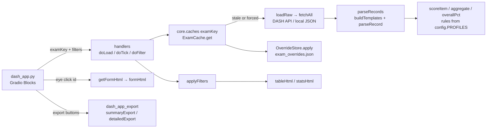

# `dash_app.py` — DASH · Assessment Monitor (Viva + SCBD + CBD + Oral Presentation)

> One Gradio 6 web app that replaces `viva_gradio.py`, `scbd_gradio.py` and `cbd_gradio.py`, and adds the
> BOH3 Oral Presentation forms (OCT, OHTR, ECCA).
> An **Exam** dropdown picks the DASH endpoint; every exam shares the same engine: a per-exam
> server-side cache, a generic form parser/scorer that reads each form's own rubric, the same
> filters, table, on-demand form view and the same comprehensive Excel workbook.
> Hand-written 2026-11-06 when the modules were added (counts from an `ast` pass on that date).

| | |
|---|---|
| **Files** | `dash_app.py` (UI + launch, 214 LOC) · [`dash_app_config.py`](dash_app_config.md) (registry + rules, 246) · [`dash_app_core.py`](dash_app_core.md) (engine + HTML, 1,133) · [`dash_app_export.py`](dash_app_export.md) (Excel, 1,683) † 2026-11-11 |
| **Top-level functions** | 13 here · 53 core (+2 classes) · 64 export (+1 class) † |
| **Imports from this codebase** | only each other (`dash_app` → config, core, export; export → config, core; core → config). Does **not** use `gradio_utils` / `cbd_gradio_utils`. |
| **Imported by** | Nothing. Not used by `main.ipynb`. |
| **Run how** | `python dash_app.py` → `http://localhost:7863` (`SERVER_PORT`). ngrok inside `__main__` when `USE_NGROK = True` (domain `NGROK_DOMAIN`). |
| **Reads** | DASH API `/assessment/<endpoint>/get` · `.env` · `<exam>_overrides.json` · `studentEmailList.csv` (roster sheet) · optional `temp 2026 <endpoint>.json` (offline) |
| **Writes** | Temp `.xlsx` files only (served for download). Never touches Postgres. |
| **Replaces** | [`viva_gradio`](viva_gradio.md) + [`gradio_utils`](gradio_utils.md), [`scbd_gradio`](scbd_gradio.md), [`cbd_gradio`](cbd_gradio.md) + [`cbd_gradio_utils`](cbd_gradio_utils.md). The old apps still work and were not modified. |

---

## 0. Changes since this document was written

> **Changed 2026-11-11 (paired examiners).** BOH viva has two forms per student: **Examiner 1** (ratings + comments + critical
> error, no checklist) and **Examiner 2** (checklist + ratings + comments). New exam option
> `EXAMS["Viva"]["pairing"] = {"roleField": "examiner", "scorerRole": 2, "otherRole": 1, "matchOn": ["Student", "Cohort"]}`.
> Exports (Summary and Detailed) now merge them into **one row per student** (`pairSittings()` in `dash_app_export.py`):
> per role the submitted, latest form; score / sections / items from E2; every scale shown as E1 · E2 · Δ; Assessor 1 / 2,
> Comments E1 / E2, critical error E1 / E2. New/changed sheets for paired rows only: **Records (E1+E2)**, Scores (Student
> block, rating E1/E2/Δ columns, both comment sets), **Std Setting** (BLR + BGM side by side on E2's rating, E1's independent
> rating and their mean), **Examiner Agreement** (exact / adjacent %, linear κ, Spearman, E1 × E2 cross-tab, by examiner pair,
> ≥ 2-level list), Assessors (+ ratings given as E1 / E2 and own − partner), Students (mean / lowest rating over both),
> Follow-up (lower of the two ratings, missing / unsubmitted partner form, examiners ≥ 2 levels apart; mean-rating BLR cut
> for "below cut"). Forms without a role (DDS4 viva) and CBD / SCBD / Oral Presentation exports are **unchanged** — verified
> cell-for-cell against the previous code. Core: rows carry `_role` (`examinerRole()`). The dashboard table is unchanged
> (one row per form).

> **Changed 2026-11-11.** New profile **`binaryRaw`** (Yes = 1, No = 0 by label; blank = 0 kept in the max; Total = number
> of Yes; Overall % = Total ÷ items). Viva rule `{"keyRegex": r"^(BOH-Viva-EOY|BOH2-Viva)$", "profile": "binaryRaw"}` (by checklist key) → BOH2 viva checklists
> `BOH-Viva-EOY` (BOH2 EOY Viva, 97 items) and `BOH2-Viva` (68 items). Scores unchanged from the previous `label5Raw`
> slot fallback (e.g. form 506 74/97 = 76.3%), now explicit.

> **Changed 2026-11-09 (build 20261109a).**
> 1. **Oral Presentation exam** (`oral-presentation` endpoint, BOH3): checklists BOH3-OCT, BOH3-OHTR, BOH3-ECCA. OCT/OHTR use
>    the new `oralFromOne` profile — same scoring as `oral_pres_utils.py` (best = n … worst = 1, Missing/blank 0; OCT item
>    weights MC1 ×3, MC2 ×2, others ×1; form % = Σw·points ÷ (max·Σw)). Verified identical on all 157 forms.
> 2. **ECCA combined performance matrix** (`eccaMatrix` profile, `overall: "matrix"`): Overall % = matrix[Presentation][Questioning];
>    Patient Safety = Unsafe → auto fail, Overall % = min(matrix %, 45%) (`unsafeCap`), flagged as a critical concern
>    (⛔), "UNSAFE — auto fail" on Follow-up. Outcome + descriptor shown in the form view and an **Outcome** column.
> 3. **Checklists multi-select** replaces the single Checklist dropdown (none ticked = all; one ticked = section columns).
> 4. New profile keys: `points: "fromOne"`, `itemWeights`, `sectionsByItem`, `itemShorts`, `showCodes`, `matrix`.
> 5. New **Double Marking** sheet (any exam): E1 vs E2 % by form-id order, gap flag (≥ `DOUBLE_MARK_GAP` 10), mean |gap|,
>    r, per-item exact agreement + linear weighted κ, Final % = mean of the student's forms (matches `oral_pres_utils`).
> 6. Std Setting is skipped for checklists without any GR (OCT/OHTR). Scores-sheet item cells show weight × points with
>    "(×w, /max)" headers. Analyses use the unrounded Overall % (`_pctExact`).
> 7. "GR blank" no longer counts as *submitted incomplete* when the form has no GR scale.
> 8. Overrides file name = slug of the exam key (`oral_presentation_overrides.json`).
> 9. **Re-applied the 2026-11-06 OM-OS fix below** — that copy to the folder had silently not landed.

> **Changed 2026-11-06 (same day).** OM-OS: a section's % now uses **its group's** method
> (`sectionMethod()` in core), so the OS section % = OS total % (item mean); previously the section
> column was pooled (Σ/Σ) and disagreed with the OS half of the overall. Group columns renamed
> **"OM total %" / "OS total %"** (Records, Scores summary block, table tooltip, form view).

---

## 1. Where the rules live (read this before changing any scoring)

Everything that is a *policy decision* lives in **`dash_app_config.py`**. The engine in
`dash_app_core.py` only executes those rules. Nothing about items, maxima, sections, domain names
or GR labels is hard-coded — those are read from each form's JSON.

| If you want to change… | Edit | Notes |
|---|---|---|
| Points for an answer label (e.g. Done Well = 4) | `PROFILES[<profile>]["labelMap"]` | `LABEL5` is shared by CBD + Viva; DDS3-CBD has its own map |
| Points by number of levels (SCBD 2/3/4/5-level schemes) | `LEVEL_SCHEMES` | worst → best, used by `points: "levels"` profiles |
| Whether blank items count as 0 | `PROFILES[…]["unansweredAsZero"]` | CBD/Viva True (blank stays in max); SCBD False (left out) |
| How a **section** % is built | `PROFILES[…]["sectionPct"]` (`pooled` / `itemMean`) | overridden per group by `groups` (OM-OS) |
| How **Overall %** is built | `PROFILES[…]["overall"]` (`raw`, `item`, `sections`, `groups`) | see §4.4 |
| Domain weights (DDS3-CBD 15/10/25/20/25/5) | `PROFILES["dds3CbdWeighted"]["weights"]` | keys are section short labels (`D1`…) |
| OM/OS split and 50:50 | `PROFILES["omos"]["groups"]` | `(label, section-name regex, % method, weight)` |
| Which checklist uses which profile | `EXAMS[<exam>]["profileRules"]` then `defaultProfile` | first rule that matches wins (§4.2) |
| Which scale is the GR | `EXAMS[…]["grScales"]` | Viva BOH3 uses `scale-practice-readiness` |
| Borderline GR for BLR/BGM | `EXAMS[…]["borderline"]` | default 2 |
| Cohorts, default cohorts, default dates | `EXAMS[…]` | |
| Add a new exam (e.g. OSCE, oral presentation) | add an `EXAMS` entry | endpoint + cohorts + profile; nothing else needed |
| Penalties / ignored assessors | `<exam>_overrides.json` (no restart) | §6 |
| Thresholds (R², BGM n, α, leniency) | bottom of `dash_app_config.py` | §8 |
| Merge two examiners' forms into one row per student (exports) | `EXAMS[…]["pairing"]` (`roleField`, `scorerRole`, `otherRole`, `matchOn`) | Viva only (BOH viva `form.examiner` = 1 / 2); remove the key to export one row per form again |
| Scoring Guide text shown in Excel | `PROFILES[…]["guide"]` | keep in step with the numbers |
| Oral presentation item weights | `ORAL_ITEM_WEIGHTS` (used by `PROFILES["oralFromOne"]["itemWeights"]`) | **duplicate of `oral_pres_utils.ORAL_ITEM_WEIGHTS`** — change both |
| ECCA matrix % / outcomes / descriptors | `ECCA_MATRIX` (+ `ECCA_ROW_LABELS`, `ECCA_COL_LABELS`) | keys = (presentation code, questioning code) |
| ECCA pass mark, unsafe cap | `PROFILES["eccaMatrix"]["matrix"]["passMark"]` / `["unsafeCap"]` | unsafe → min(matrix %, cap) |
| Which ECCA item is row / column / safety | `matrix["rowItem"]`, `["colItem"]`, `["safetyItem"]` (regex on question text), `["unsafeRegex"]` (rubric wording) | |
| Item-per-column tables (oral) | `PROFILES[…]["sectionsByItem"]`, `["itemShorts"]`, `["showCodes"]` | |

**Current rules (2026-11-06)**

| Profile | Used by | Item points | Blank items | Section % | Overall % |
|---|---|---|---|---|---|
| `label5Raw` | CBD (DDS4), Viva (DDS4 + BOH3) | by option label: Done Well 4, Done 3, Mostly Done 2, Sometimes Done 1, Not Done 0; custom labels (Yes/No, Complete/Incomplete) by slot, best = n−1 | 0, kept in max | pooled Σ/Σ | raw Σpoints ÷ Σmax |
| `levelsItemMean` | SCBD default (DDS3-10-JUN, AM/PM) | rank among the item's enabled options: 2 levels 0/1, 3 → 0/1/2, 4 → 0/2/3/4, 5 → 0/1/2/3/4 | excluded | mean of item point/max | mean of item point/max |
| `dds3CbdWeighted` | SCBD checklists with a "Partially Done" option | Done Well 3, Done 2, Partially Done 1, Not Done 0, Yes 2, No 0 | excluded | pooled | Σ weight × domain % (D1 15, D2 10, D3 25, D4 20, D5 25, D6 5); missing domain = 0% |
| `omos` | SCBD checklists whose headers start "Oral Medicine/Surgery" | level scheme (as SCBD) | excluded | OM sections pooled · OS sections item mean | 50% OM total (pooled over all OM items) + 50% OS total (item mean) |

| `oralFromOne` | Oral Presentation OCT, OHTR (and any new oral checklist) | best real option = n … worst = 1; option "Missing" or blank = 0 (OCT Exemplary 4 … Unsatisfactory 1; OHTR Excellent 4 … Poor 1) | 0, kept in max | pooled with item weights | Σ w·points ÷ Σ w·max (OCT weights MC1 ×3, MC2 ×2, MC3–5 ×1) |
| `binaryRaw` | Viva BOH2 (`BOH-Viva-EOY`, `BOH2-Viva`; rule `keyRegex: ^(BOH-Viva-EOY\|BOH2-Viva)$`) | Yes 1, No 0 (by label) | 0, kept in max | pooled | raw: Total = number of Yes ÷ items |
| `eccaMatrix` | Oral Presentation BOH3-ECCA (rule `keyRegex: "ECCA"`) | B1 0 · B2 1 · M1 2 · M2 3; Safe 1 / Unsafe 0 (item analysis only) | excluded | per item | **matrix** lookup below; Unsafe → min(matrix %, 45%) |

**ECCA combined performance matrix** (`ECCA_MATRIX`; Presentation rows × Questioning columns; pass mark 50%):

| Presentation ↓ / Questioning → | B1 Significant gaps | B2 Partial understanding | M1 Meets minimum | M2 Strong reasoning |
|---|---|---|---|---|
| **B1** Below minimum, limited reasoning | 25 Fail | 35 Fail | 50 Pass | 65 Pass |
| **B2** Below minimum, some reasoning | 38 Fail | 45 Fail/Supp (marginal) | 60 Pass | 70 Pass |
| **M1** Meets minimum, limited rationale | 55 Pass | 60 Pass | 75 Pass | 85 Above standard |
| **M2** Meets minimum, strong rationale | 60 Pass | 70 Pass | 85 Above standard | 100 Above standard |

Patient Safety **Unsafe** = automatic fail: Overall % = min(matrix %, `unsafeCap` 45), i.e. always below the 50% pass mark
(45 = the highest fail cell; change `unsafeCap` if a different value is wanted). ECCA answers are stored as the option
codes (O1 M2 · O2 M1 · O3 B2 · O4 B1); the safety item reuses those slots (O1 = "Safe: …", O4 = "Unsafe: …"), so
unsafe is detected from the **rubric wording** of the chosen option (`unsafeRegex`), not the stored code.

Item **max** is always the best option *shown on that form* (non-empty rubric slot), so a form
version with fewer options automatically has a lower max — e.g. DDS4 CBD Domain 2 items cap at Done.

---

## 2. Purpose and role

Live monitoring screen for oral/discussion exams while a sitting runs, plus the post-sitting
analysis workbook. Not part of the batch reporting pipeline (`main.ipynb`) and never reads Postgres.

Why one app: the three old apps shared ~70% of their code by copy-paste and had drifted
(token caching, page size, exclusion rules, caching, form HTML). The merged app keeps CBD's
efficiency features for every exam and makes the scoring data-driven.

---

## 3. Architecture



### 3.1 Request flow

| Event | Handler | API call? | Re-parse? |
|---|---|---|---|
| Page open | `demo.load → doLoad` | only if cache older than `CACHE_TTL` (30 s) | only if payload hash changed |
| **Load** button | `doLoadForce` | always | if hash changed |
| Exam dropdown | `doExamChange` (cohorts, dates, checklist reset) → `doLoad` | if that exam's cache is stale | — |
| Cohort tick | `doLoad` (in-memory slice, refreshes the Checklists choices, drops ticked ones no longer present) | if stale | — |
| Any other filter | `doFilter` | **never** | never |
| Timer tick | `doTick` | if stale | re-renders **only** when the cache `version` moved → idle tabs send nothing |
| Eye button | JS `openForm(id)` → hidden `#form-req` → `getFormHtml` | never | never (HTML built for that one row) |
| Export buttons | `doExport` / `doExportDetailed` | never (uses cache) | never |

### 3.2 Caching

`core.caches = {exam: ExamCache}` — **one cache per exam, shared by every browser tab and user**.
`ExamCache.get(force)` holds a lock, so simultaneous requests wait for one fetch instead of
duplicating it. It always fetches **all cohorts** of the exam; cohort filtering is in memory.
`fetchedAt` is set even on failure (no hammering a failing API) and the last good rows stay on
screen with "(showing last good data)". `version` increments on new data or an overrides-file
change; the per-tab `versionState` lets the timer skip re-renders.

### 3.3 Auth

`getToken()` logs in with `DASH_EMAIL` / `DASH_PASSWORD` from `.env` (file values win over stale
OS env vars), caches the token, and `loadRaw` re-logs in once on 400/401/403. Credentials are never
printed (the old SCBD app printed them on login failure). App login gate: `DASH_APP_USERNAME` /
`DASH_APP_PASSWORD`, falling back to `CBD_USERNAME` / `CBD_PASSWORD`; blank = no gate.

---

## 4. Data model and the generic parser

### 4.1 Raw DASH record (all three endpoints share it)

```json
{
  "id": 287, "datetime": "2026-10-12T00:00:00+11:00", "student": "…", "assessor": "…",
  "cohort": "DDS3", "subject": "DENT90151", "submitted": true,
  "form": {
    "checklists": {                        // one or more checklist templates
      "SCBD_OM-OS": {
        "name": "SCDB Oral Med and Oral Surg",
        "fields":  {"MC1": "Identifies persistence beyond 2–3 weeks.", "…": "…"},
        "extra_config": {
          "options": {"assessor": {"O1": "Excellent", "O2": "Satisfactory", "O3": "Borderline", "O4": "Unsatisfactory"}},
          "rubric":  {"MC1": {"O1": "Yes", "O2": "", "O3": "", "O4": "No", "label": "<p>…</p>"}},   // "" = option hidden
          "headers": {"MC1": [{"title": "Oral Medicine – Case Scenario 1 (/8)"}, {"title": "Question 1. …"}]}
        }
      }
    },
    "scales": {"scale-global-rating": {"name": "Global Rating Scale",
               "fields": {"1": "Fail", "2": "Borderline Fail", "3": "Pass", "4": "Very Good", "5": "Excellent"}}},
    "examiner_2": "Name" ,                 // Viva BOH3 has "examiner": 1|2 instead
    "data": {"assessor": {
      "SCBD_OM-OS": {"MC1": "Excellent", "MC2": "Unsatisfactory"},   // answers = OPTION labels
      "SCBD_OM-OS_comments": "…", "comments": "…",
      "scale-global-rating": {"scale": "3"},
      "critical_concerns": "Yes", "critical_concerns_comments": "…",  // SCBD/CBD
      "critical_error": "…", "clinical_incident": "…"                // Viva
    }}
  }
}
```

Observed shapes (saved JSON, 2026-11-06):

| Exam | Checklist templates | Answer labels | GR scale |
|---|---|---|---|
| CBD | `d1-dds4`…`d6-dds4` (6 parts on one form) | Done Well … Not Done | `scale-global-rating` |
| Viva | `DDS4-1`…`DDS4-5` (5 parts) · `BOH3-2026` (one checklist, 4 header sections) · BOH3 examiner-1 forms have **no** checklist | Done well … Not done · Complete/Incomplete | GR · BOH3 `scale-practice-readiness` (4 levels) |
| SCBD | one per form: `DDS3-10-JUN`, `SCBD_OM-OS`, `DDS3-SCBD-AM`, `DDS3-SCBD-PM`, `DDS3-CBD` | varies; rubric may hide options per item | GR (4 forms: `-om` / `-os` split) |
| Oral Presentation | one per form: `BOH3-OCT` (5 items, no headers), `BOH3-OHTR` (6 items; option O5 "Missing" hidden in the rubric), `BOH3-ECCA` (MC1 Case presentation, MC2 Questioning, MC3 Patient Safety) | OCT Exemplary/Proficient/Developing/Unsatisfactory · OHTR Excellent/Good/Satisfactory/Poor/Missing · ECCA M2/M1/B2/B1 | OCT/OHTR **none**; ECCA GR + Readiness to practice |

### 4.2 Templates and profile choice — `buildTemplates()`

Checklist keys that occur together on a form are grouped (union-find) into a **template**:
`d1…d6-dds4` → one template "DDS4 (6 parts)"; each SCBD checklist → its own template. Per key the
newest *rich* meta (has options + fields) is kept. The template's **sections** are:

- multi-checklist template → one section per checklist (short label from its name: "Domain 2 — …" → `D2`);
- single checklist → one section per header block. When any item has multi-level headers
  (`[top, sub]`, e.g. OM-OS), sections are the **tops** and subs become sub-blocks.

Short labels (`shortLabel`): `DOMAIN n`/`Domain n` → `Dn`; "Oral Medicine – Case Scenario n" →
`OMn`; "Oral Surgery…" → `OS`; "3. …" → `S3`; else `S<i>`. Section identity on a single-checklist
template is the **short label**, so older form versions with reworded headers still line up.

Profile = first `profileRules` entry whose test matches any checklist in the template
(`optionsAny`: any assessor option label; `headerRegex`: any header title; `keyRegex`: checklist
key), else `defaultProfile`.

### 4.3 Item scoring — `scoreItem(value, meta, mc, profile)`

1. `enabledSlots`: rubric slots with a non-empty label (all option slots if the item has no rubric).
2. `findSlot`: stored answer → slot by matching the option label, then the rubric label, then a literal `O3`.
3. `slotPoints` per profile `points`: `labelMap` (label → points, custom label → `nOpts − slotNumber`),
   `levels` (rank in enabled slots through `LEVEL_SCHEMES`), `slot` (linear), `fromOne` (best real option = n …
   worst = 1, a "Missing" option = 0).
4. Item max = max points over enabled slots. Display = stored label + rubric wording when it differs
   (`Mostly Done · Yes`, `Done · ≥ 2`; wording before a colon only, e.g. `B1 · Unsafe`). Each item also carries
   `weight` (profile `itemWeights[checklist][MC]`, default 1), `code` (the option label of its slot, e.g. `M2`) and
   `rubric` (the chosen option's rubric wording).

### 4.4 Section and overall — `aggregate()`, `sectionMethod()`, `overallPct()`

`aggregate(items, unansweredAsZero, method)` → `score`, `max`, `pct`, `answered`, `n`.
`pooled` = 100·Σw·points/Σw·max; `itemMean` = 100·Σw·(points/max)/Σw (w = item weight, 1 unless `itemWeights`). `sectionMethod` returns the
section's group method when the profile has `groups`, else `sectionPct`.

| `overall` | Formula |
|---|---|
| `raw` | pooled over every item on the form |
| `item` | item mean over every item |
| `sections` | Σ wₛ·pctₛ ÷ Σ wₛ (weights by short label, `None` = equal; `missingAsZero` keeps a blank section's weight at 0%) |
| `groups` | per group (sections whose **name** matches the regex): its method over the group's items; then weighted mean of the groups present |
| `matrix` | `matrixResult()`: codes of the row / column items (found by regex on the question text) → `matrix["table"][(row, col)]`; blank row or column → no %; unsafe safety answer → min(%, `unsafeCap`). Returns the outcome text and descriptor; no points Total is shown |

A form with **no answered item** gets no Overall % (blank, not 0%) and no Total.

**Worked example (SCBD_OM-OS, Bilal Adnan):** OM1 12/17 = 70.6%, OM2 11/20 = 55.0%; OM total =
23/37 = 62.2% (pooled). OS items 0/2, 3/4, 2/4, 2/2, 3/4, 1/2, 2/4, 3/4, 3/4 → item mean 61.1%
(pooled would be 19/30 = 63.3%, not used). Overall = ½(62.2 + 61.1) = **61.6%**.

### 4.5 Parsed row (`parseRecord`)

| Key | Meaning |
|---|---|
| `Date, Student, Assessor, Examiner, Cohort, Subject, Checklist` | display fields (`Examiner` = `examiner_2` name or "Examiner n") |
| `GR, GR_int, GR_label` | primary scale (first of `grScales` present), label from the form's scale |
| `Total, Max, Pct` | raw points / max / Overall % (−1 = none) — `Pct` is **after** overrides |
| `CC, CC_int` | critical concerns: Yes, or meaningful `critical_error` / `clinical_incident` text |
| `Status` | Submitted · In progress (any item, comment, GR or CC filled) · Not started |
| `Comments, Missing` | `[Label] text` lines; sections not in this form |
| `_sec` | `{secKey: {name, short, present, score, max, pct, answered, n}}` |
| `_items` | `[{ck, mc, secKey, sub, section, points, max, value, disp, question}]` |
| `_groupPct` | `{"OM": 62.2, "OS": 61.1}` for `groups` profiles |
| `_incomplete` | submitted but: GR blank, section not in form, n items blank, checklist empty |
| `_pctBase, _penalty, _overrideNote, _ignored` | set by overrides |
| `_pctExact` | unrounded Overall % (all Excel analyses use it) |
| `_outcome, _outcomeDesc, _unsafe` | matrix result text, cell descriptor, safety flag (ECCA); unsafe also sets `CC_int` = 1, `CC` = "Unsafe" |
| `_ad, _gr, _extraScales, _tid, _profile, _id, _ts, _scored, _nItems, _stateRank` | raw assessor data and helpers |

---

## 5. UI

Header row: build stamp · **Exam** dropdown · subtitle. Row 1: From / To (YYYY-MM-DD), Refresh
interval, Load. Row 2: Cohorts · **Checklists** multi-select (templates present in the chosen cohorts; none ticked = all) ·
Search · Sort · Submitted only / Unsubmitted only · Critical concerns only / **Hide dummy/test**
(ticked by default). Stat cards: Records, Submitted, In progress, Avg GR, Avg overall %, Critical
concerns, Students, Assessors, Needs attention.

Table: section columns appear when the view holds **one** template with ≤ `MAX_SECTION_COLS`
sections (tick one checklist for SCBD / Oral Presentation; oral checklists show one column per criterion, weighted
points / max; ECCA shows the level codes Pres · Quest and Safe/Unsafe); amber cell = section not in this form; Checklist column only
when several templates are in view; Cohort / Examiner columns only when informative. Status ✓ /
✓! (submitted but incomplete, hover for why) / x/y items (✎ comments started) / ✗. Penalties show as
a red superscript on %. Double-click a comment → full comment modal. Eye → full form (sections,
sub-blocks, every item with label and points, per-checklist comments, critical, general, extra
scales, scoring profile, override/missing/incomplete banners).

Default sort: status (submitted → in progress → not started), newest first within each, with
divider rows. Search covers student, assessor, examiner, cohort, subject, checklist, comments.

---

## 6. Overrides — `<exam>_overrides.json`

Same format as the existing `cbd_overrides.json` (which is picked up unchanged for CBD). File name = exam key
lower-cased with non-alphanumerics → `_`: `cbd_`, `scbd_`, `viva_`, `oral_presentation_overrides.json`. Re-read
whenever the file's modified time changes — no restart.

```json
{
  "overrides": [
    {"student": "Jane Doe", "penaltyPct": 10, "reason": "late submission", "by": "CM"},
    {"formId": 1234, "penaltyPct": 5, "method": "relative"}
  ],
  "ignoreAssessors": ["Assessor Name"]
}
```

- Match by `student` (case/space-insensitive, bracketed nicknames ignored) and/or `formId` (both
  must match when both given). Default `method` absolute = subtract %-points; `relative` = % of score.
- Penalties change `Pct` only; raw Total unchanged; the note appears in the table, form view and as
  an Excel cell comment on Total / Overall %. **All analysis uses the pre-penalty `_pctBase`.**
- `ignoreAssessors`: their forms stay in the dashboard table but go to an **Ignored Assessors**
  sheet in exports and are excluded from every analysis sheet.
- Unmatched entries are reported in the red status bar.

---

## 7. Excel exports (`dash_app_export.py`)

**Export Summary** → Records (+ Ignored Assessors, About). **Export Detailed** → the full workbook
below; one set of checklist sheets per template present (suffix = template label when there is
more than one). Sheets with nothing to show are skipped.

| Sheet | Content |
|---|---|
| **Overview** | Key figures; per-checklist table (profile, forms, mean %, α, BLR cut (R²), BGM cut (n)); how each checklist is scored (profile guide + section items/max/weights); GR scale from the forms; colour legend; sheet guide |
| **Records** | One row per form: ID, identity, status, items scored, GR (+ extra scales), section % (single template), OM/OS total %, Total, Max, Overall %, pre-override %, override note, CC, not-in-form, submitted-incomplete, comments. Autofilter, frozen panes, override comments. |
| **Follow-up** | Forms needing action with reasons: critical concern, submitted incomplete / not in form, in progress, not started, GR ≤ borderline, below the checklist's BLR cut, override applied |
| **Students** | Per student × cohort: forms, submitted, checklists, mean/min/max %, mean/lowest GR, CC count, below-cut count, **Review** flag, assessors |
| **Scores …** | Per template: identity · per section (and sub-block) MC columns "MCn (/max)" coloured by fraction, question text as a header comment · section Score + % · summary (GR, extra scales, group totals, Total, Max, Overall %, CC, not-in-form, override) · comments (general, per-checklist, critical) |
| **Std Setting …** | BLR and BGM side by side (cut, 95% CI, n, pass count, slope, intercept, R², SEE, borderline mean/median/SD/range) — **no recommended cut**; viability tests (n, GR levels, borderline inside range, R², slope sign + p, inter-grade discrimination, CI width, borderline group size/SD, monotonic grade means, Spearman ρ, BLR–BGM agreement) with PASS/WARN/FAIL; Overall % by GR; per-section BLR/BGM cuts; scatter + trendline with both cut markers; bar of mean % by GR (borderline highlighted) |
| **Sections …** | Per section: items, n, mean, SD, min, median, max, % full marks, Cronbach α, Spearman ρ with GR, r with overall; whole-checklist α; mean section % by GR level; section intercorrelation matrix; bar chart |
| **Items …** | Per item: section, question, n answered, blanks, difficulty p, SD, corrected item-rest r, α-if-deleted, D (top − bottom 27%), 2PL-lite a/b, importance (RandomForest if scikit-learn, else \|r\|) + rank, % full/partial/zero, flag (Good/Review/Poor/Too easy/Too hard/No variance); scatter p vs r; bar of r |
| **Assessors** | Forms, submitted, students, mean %, SD, mean GR, GR 1…5 counts, % GR ≤ borderline, CC, open forms, Δ vs cohort, **GR-adjusted Δ** (mean of score − BLR-predicted score from the GR they gave), Lenient/Harsh/Typical flags (±max(5, 0.67·SD of assessor means), ≥ 3 submitted), checklists; bar chart |
| **Roster** | Per cohort vs `studentEmailList.csv` (`cohort`, `student_name`): missing, off-roster, same checklist twice |
| **Double Marking** | Only when ≥ 3 students have 2+ submitted forms on the same checklist. Per checklist: pairs, mean \|gap\|, pairs with gap ≥ 10, mean E2 − E1, r(E1, E2); per item: exact agreement %, linear weighted κ, mean level gap; per student: E1/E2 assessor and %, gap, flag, Final % (mean of all forms), outcomes. E1/E2 = form-id order |
| **Ignored Assessors** | Records-format sheet of excluded forms (grey tab) |
| **Records (E1+E2)** | Paired exams (BOH viva): one row per student — E2/E1 form IDs, Assessor 1 (E1), Assessor 2 (E2, scorer), status of each form, pairing issues, each scale E1 · E2 · Δ (Δ ≥ 2 orange), section %, Total, Overall %, critical (E1 · E2), Comments E1, Comments E2. Named "Records" when every row is paired |
| **Examiner Agreement** | Paired exams: per scale — exact %, adjacent (±1) %, mean E2 − E1, linear κ, Spearman ρ, E1 × E2 cross-tab; by examiner pair; students with ratings ≥ 2 levels apart (with both comments) |

**Paired (BOH viva) versions of the other sheets** (2026-11-11): Scores — "Student" block with Assessor 1/2, Status E1/E2,
pairing issues; summary has every scale as E1 · E2 · Δ; comments block Comments E1/E2 + critical error E1/E2. Std Setting —
BLR + BGM against **E2 (scorer)**, **E1 (independent)** and **mean** rating side by side (mean: BGM borderline group = mean exactly
the borderline level), viability tests per source, Overall % by rating level (half steps for the mean), per-section BLR per
source, one scatter with three trendlines; the mean-rating BLR is the reference cut for Follow-up / Students. Assessors — extra
table: ratings given as E1 and as E2, % ≤ borderline, mean (own − partner), tendency. Students / Follow-up — ratings from both
examiners, the lower one drives the borderline flag; missing / unsubmitted partner form and ≥ 2-level disagreements are reasons.
Sections / Items keep using E2's rating for ρ with GR.

2026-11-09 additions: **Outcome** column on Records when any form has a matrix result; Overview prints the ECCA matrix and
a count of forms per cell + unsafe count; Scores item cells show weight × points with "(×w, /max)" headers (colour still
by the unweighted level); Std Setting is not created for a checklist with no GR at all (OCT/OHTR).

Colour scale for fractions/%: ≥ 99% `BBFFD9`, ≥ 70% `BFDBFE`, ≥ 45% `A5F3FC`, > 0 `FEF08A`, 0 `FECACA`;
GR 5→1 green→red; amber `FEF3C7` = section not in form; orange `FED7AA` = incomplete / borderline.

---

## 8. Configuration reference (`dash_app_config.py`)

| Constant | Value (2026-11-06) | Meaning |
|---|---|---|
| `API_BASE`, `YEAR`, `PAGE_SIZE` | DASH, "2026", 200 | API |
| `CACHE_TTL` | 30 | seconds between DASH pulls per exam |
| `LOCAL_JSON_DIR` | "" | "." = read `temp 2026 <endpoint>.json` (offline testing) |
| `EXCLUDE`, `EXCLUDE_SUBSTRINGS` | 3 names; dummy, test | exact names always dropped; substrings only with Hide dummy/test |
| `SERVER_PORT`, `USE_NGROK`, `NGROK_DOMAIN` | 7863, True (set by Kunal), app.mds-dash.ngrok.app | server |
| `CONCURRENCY` | 5 | parallel runs per handler |
| `OVERRIDES_SUFFIX`, `ROSTER_CSV` | `_overrides.json`, `studentEmailList.csv` | |
| `LABEL5`, `LEVEL_SCHEMES`, `PROFILES`, `EXAMS`, `DEFAULT_EXAM` | §1 | rules |
| `GR_COLORS`, `COHORT_COLORS`, UI sizes, `TABLE_COLS`, `MAX_SECTION_COLS` | | appearance |
| `INTERVAL_MAP`, `DEFAULT_INTERVAL`, `SORT_OPTIONS`, `DEFAULT_SORT`, `STATUS_RANK` | | UI |
| `SS_MIN_N` 10, `BGM_MIN_BORDERLINE` 5, `R2_MIN` 0.5, `DISCRIM_*` 10 / 5 / 16.7, `METHOD_AGREE_TOL` 5 | | standard-setting tests |
| `ALPHA_GOOD` 0.7, `LENIENCY_MIN_CUT` 5 | | analysis flags |

Exams: **CBD** (`cbd`, BOH3/DDS3/DDS4, default DDS4, 1–30 Nov), **SCBD** (`scbd`, DDS2/DDS3,
default DDS3, Oct–Dec), **Viva** (`viva`, BOH3/DDS2/DDS3/DDS4, default BOH3+DDS4, Jun–Dec), **Oral Presentation**
(`oral-presentation`, BOH3, Sep–Dec; default profile `oralFromOne`, rule `keyRegex: "ECCA"` → `eccaMatrix`).

Added 2026-11-09: `ECCA_MATRIX`, `ECCA_ROW_LABELS`, `ECCA_COL_LABELS`, `ORAL_ITEM_WEIGHTS`, `DOUBLE_MARK_GAP` (10).

---

## 9. How-to recipes

**Add an exam** (e.g. oral presentations):
```python
EXAMS["Oral Pres"] = {"title": "Oral Presentation", "endpoint": "oral-presentation",
    "cohorts": ["BOH3"], "defaultCohorts": ["BOH3"], "dateFrom": "2026-10-01", "dateTo": "2026-12-31",
    "defaultProfile": "label5Raw", "profileRules": [], "grScales": ["scale-global-rating"], "borderline": 2}
```
Test offline first: `LOCAL_JSON_DIR = "."` with `temp 2026 oral-presentation.json` beside the app.

**Merge examiners for another exam:** add `"pairing": {"roleField": "<form field holding 1/2>", "scorerRole": 2,
"otherRole": 1, "matchOn": ["Student", "Cohort"]}` to its `EXAMS` entry. Only forms that carry a role are merged.

**New scoring rule for one checklist:** add a `PROFILES` entry, then a `profileRules` line on the
exam, e.g. `{"keyRegex": r"^DDS3-NEW", "profile": "myProfile"}`. Rules are tried in order.

**Change DDS3-CBD weights:** edit `PROFILES["dds3CbdWeighted"]["weights"]` (keys D1…D6) and its `guide`.

**Change the BOH3 viva borderline:** `EXAMS["Viva"]["borderline"]` (applies to every Viva template).

**Switch CBD to equal-weighted domains:** set `PROFILES["label5Raw"]["overall"] = "sections"`
(weights `None` = equal) — note this also changes Viva DDS4; copy the profile under a new name and
point CBD's `defaultProfile` at it to change CBD alone.

**Change the ECCA unsafe rule:** `PROFILES["eccaMatrix"]["matrix"]["unsafeCap"]` (e.g. 49 or 25). A matrix cell's %:
edit `ECCA_MATRIX[(presentation, questioning)]`.

**Change oral weights:** `ORAL_ITEM_WEIGHTS` here **and** `oral_pres_utils.ORAL_ITEM_WEIGHTS` (Excel/PDF reports), so
the dashboard and the reports agree. A new oral checklist with no entry gets equal weights.

After any rule change: restart the app (config is read at start-up); overrides need no restart.

---

## 10. Verification (2026-11-06, saved JSON)

Compared row-by-row with the legacy apps' own functions on the same JSON:

| Exam | Compared | Result |
|---|---|---|
| CBD | 131 forms (Overall %, Total, Status, CC) | identical (after not-started forms → blank, matching legacy) |
| Viva DDS4 | 113 scored forms (Total) | identical; rubric-derived maxima = old `DOMAIN_MAX` (16/19/34/31/16 = 116) |
| SCBD | all checklists (Overall %) | ≤ 0.1 %-pt (legacy rounds OM%/OS% before averaging); two partial **Dummy Student** forms differ because legacy mapped sections from answered items only (OS items fell into OM) — new code uses the form's full item list |

| Oral OCT / OHTR (2026-11-09) | 83 + 74 forms (form %) and 37 + 33 double-marked students (Final %, gap) vs `oral_pres_utils.loadOralPresentation` | identical |
| ECCA (2026-11-09) | 32 synthetic forms: all 16 matrix cells × Safe/Unsafe, plus a blank-questioning form | all correct (unsafe → 45%, CC, outcome) |

Browser test (Playwright): load, exam switch, checklist multi-select (one → section columns, two → Checklist column),
section columns, eye → form modal (ECCA result banner), detailed export download; no JS errors.

---

## 11. Gotchas

- **Gradio versions:** `sanitize_html=False` is passed to `gr.HTML` only if the installed Gradio
  has that parameter (`HTML_KW`); without it the eye/comment `onclick` handlers would be stripped on
  versions that sanitize. `css`, `head`, `theme` are passed to `launch()` (Gradio 6 API).
- **Two exams, one timer:** the timer only refreshes the exam currently selected in that tab.
- **Paired viva rows:** pairing is by examiner role, not cohort — a DDS3/DDS4 test form that happens to carry `examiner`
  is merged too (it shows "Examiner 1 form missing" etc.). BOH3 examiner-1 forms carry only Readiness to Practice (BOH2: GR + RTP).
  Items' RandomForest importance can shift slightly between runs because row order changes; all other statistics are unaffected.
- **Not started vs blank:** a form with no answered item has `Pct = −1` (shown "—"), not 0%.
- **Form versions:** every form is scored against its own rubric; Max can differ between forms of
  the same checklist (e.g. CBD 100 vs 101). Section keys on single-checklist templates are short
  labels so reworded headers still align.
- **Viva BOH3 examiner-1 forms** carry no checklist (placeholders): Checklist "—", no score.
- **BOH3 Readiness to Practice** is a 4-level scale; borderline = level 2 by default — confirm.
- **Dates** display in the server's local time zone.
- Section columns are hidden when > `MAX_SECTION_COLS`; details remain in the form view and Excel.
- **ECCA safety** is stored as the level code of its slot (Safe = "M2", Unsafe = "B1"); never read it as a level.
- **Oral weights are duplicated** in `dash_app_config.ORAL_ITEM_WEIGHTS` and `oral_pres_utils.ORAL_ITEM_WEIGHTS`.
- Double Marking pairs by **form id order** (as `oral_pres_utils`), not by an examiner role field.
- `scipy` (exact t-values) and `scikit-learn` (RandomForest importance) are optional; without them
  1.96 / |item-rest r| are used and the sheet says so.

---

## 12. `dash_app.py` functions (UI module)

| Line | Function | Signature | Purpose |
|---:|---|---|---|
| 34 | `isGrouped` | `(sortOpt)` | Status divider rows only under the status sort. |
| 39 | `checklistChoices` | `(examKey: str, cohorts)` | Checklist templates that have forms in the selected cohorts (multi-select; none ticked = all). |
| 45 | `render` | `(examKey, filterVals)` | (tableHtml, statsHtml) for the current filters from the exam cache. |
| 52 | `doLoad` | `(examKey, *filterVals, force=False)` | Exam cache (fetch if stale/forced) → filtered view. filterVals = cohorts, checklist, sub, unsub, cc, hide, q, sort, from, to. |
| 68 | `doLoadForce` | `(examKey, *filterVals)` | Load button: bypass the TTL. |
| 73 | `doTick` | `(examKey, seenVersion, *filterVals)` | Timer: refresh this exam's cache if stale; re-render only when its version moved. |
| 81 | `doFilter` | `(examKey, *filterVals)` | Any filter change: in-memory re-render, no API call. |
| 86 | `doExamChange` | `(examKey)` | Exam switch → that exam's cohorts, default cohorts, dates; checklist reset. |
| 93 | `getFormHtml` | `(examKey, req)` | Eye click: full form for one record id, built on demand. |
| 100 | `doExport` | `(examKey, *filterVals)` | Export Summary button → summaryExport on the filtered cache rows. |
| 105 | `doExportDetailed` | `(examKey, *filterVals)` | Export Detailed button → detailedExport on the filtered cache rows. |
| 110 | `setInterval` | `(choice)` | Refresh dropdown → new gr.Timer. |
| 181 | `buildNgrokPolicy` | `()` | ngrok traffic policy: OAuth sign-in → deny if email not on NGROK_EMAIL_DOMAIN → deny if not on the .env allowlist. |

Module-level: `NO_CHANGE` (`gr.skip()`), `HTML_KW` (sanitize flag when supported), `DEF_SECS`/`DEF_ACTIVE`, `e0` (default exam), `demo` (the Blocks app).
Components: `examDd`, `dateFrom`, `dateTo`, `intervalDd`, `loadBtn`, `cohortIn`, `checklistDd` (multi-select), `searchIn`, `sortDd`, `subOnly`, `unsubOnly`, `ccOnly`, `hideTest`, `statsHtml`, `errorMd`, `updatedMd`, `tableHtml`, `formReq` (hidden), `formOut` (hidden), `exportBtn`, `exportDetailBtn`, `fileOut`, `versionState`, `timer`.
Filter argument order everywhere: `cohorts, checklists (list), submittedOnly, unsubmittedOnly, ccOnly, hideTest, search, sortOpt, dateFrom, dateTo`.
